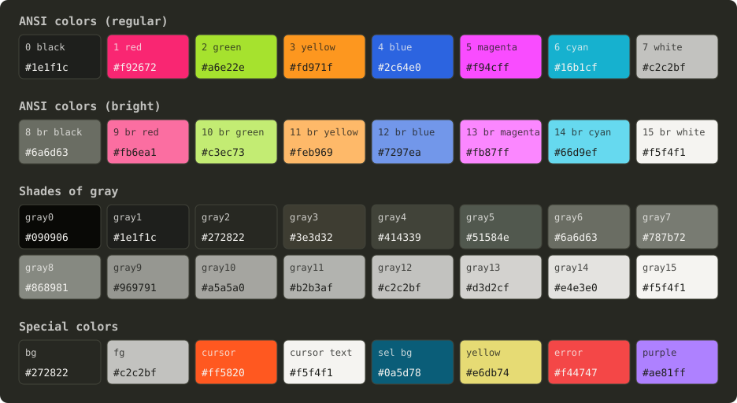

# AX-Monokai Color Scheme

The *AX‑Monokai* project defines a unified color scheme inspired by various
*Monokai*, *Molokai*, and related theme variants.

All colors are specified in a single configuration file (`AX-Monokai.conf`).
Based on this file, the project provides a `Makefile` that can automatically
generate configuration files for a wide range of applications, including
terminal emulators, text editors, web browsers, and more.



## Supported Output Formats

- CSV (`out/ax-monokai.csv`)
- foot (`out/foot.ini`)
- Ghostty (`out/ghostty.conf`)
- iTerm2 (`out/AX-Monokai.itermcolors`)
- Kitty (`out/kitty.conf`)
- POSIX Shell (`out/ax-monokai.inc.sh`)
- Vivaldi (`out/vivaldi.zip`)
- VS Code (`out/ax-monokai-<version>.vsix`, `out/vscode-color-theme.json`)
- VS Code terminal (`out/vscode-terminal.json`)

## Colors

The palette image above is generated from `AX-Monokai.conf` by running
`make palette`.

### Color palette

The following 16 colors are used for the standard ANSI palette, 8 regular/dark
colors, and 8 bright variants:

| Dark    | Bright  | Comments
|---------|---------|---------------------------------------------------------
| #1e1f1c | #6a6d63 | Monokai Pro Classic / +33%
| #f92672 | #fb6ea1 | Monokai Pro Classic + Base16 Monokai / +33%
| #a6e22e | #c3ec73 | Monokai Pro Classic + Base16 Monokai / +33%
| #fd971f | #feb969 | Base16 Monokai / +33%
| #2c64e0 | #7297ea | Alex / +33%
| #f94cff | #fb87ff | Alex / +33%
| #16b1cf | #66d9ef | -33% / Monokai Pro Classic + Base16 Monokai
| #c2c2bf | #f5f4f1 | Monokai Pro Classic / Base16 Monokai

### Shades of grey

The following 16 grayscale levels are defined:

| Color   | Comment
|---------|-------------------------------------------------------------------
| #090906 | -
| #1e1f1c | color0
| #272822 | background
| #3e3d32 | -
| #414339 | -
| #51584e | -
| #6a6d63 | color8
| #787b72 | -
| #868981 | -
| #969791 | -
| #a5a5a0 | -
| #b2b3af | -
| #c2c2bf | foreground
| #d3d2cf | -
| #e4e3e0 | -
| #f5f4f1 | color15

### Syntax colors

These colors are derived from the VS Code "Monokai Operator" syntax theme and
are only used for syntax highlighting in the VS Code color theme (they are not
part of the terminal themes):

| Color   | Name            | Comment
|---------|-----------------|-------------------------------------------------
| #e6db74 | syntax_string   | Strings, Markdown links, changed and list markup
| #ae81ff | syntax_constant | Numbers, language constants, escapes, debug tokens
| #f44747 | syntax_invalid  | Invalid code and error tokens

## Installation

1. All core definitions of the *AX-Monokai* theme are stored in a somewhat
   generic format in the `AX-Monokai.conf` file.
2. A `Makefile` for the `make` command is used to generate all theme files in
   the `out/` directory.
3. You *manually* install the themes or theme snippets from the `out/` directory
   into your local configuration files and folders as you like.

Therefore you have to:

1. Get the code :-)
2. Run `make`
3. Find the generated files from the `out/` directory
4. Copy the ones you need into your local configuration.

More detailed notes for some targets are outlined below.

### VS Code

The theme extension is available in the
[Visual Studio Code Marketplace](https://marketplace.visualstudio.com/items?itemName=alex-barton.ax-monokai).

This section describes how you can build it yourself.

Prerequisites:

- [VS Code Extension Manager](https://github.com/microsoft/vscode-vsce)

```bash
npm install -g @vscode/vsce
```

Build and package the extension, it will be stored in the `out/` directory:

```bash
# Update the version number in "package.json" as needed. Then:
make check vscode
```

Install the VS Code extension locally on your machine:

```bash
code --install-extension out/ax-monokai-${version}.vsix
```
